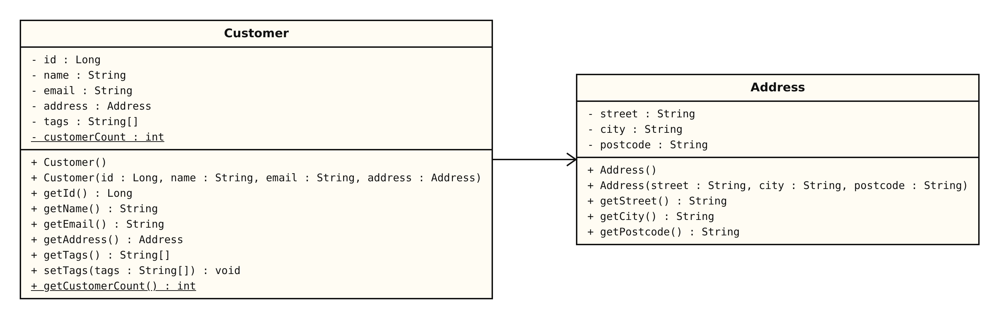
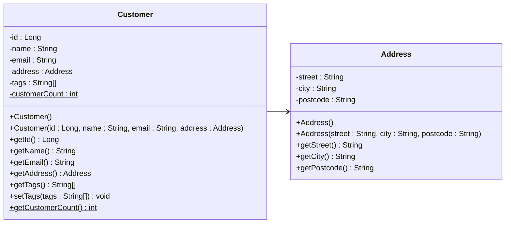

# Customer and Address — UML Class Diagram

The solid line with an open arrowhead is an **association**: a Customer *has an* Address.
The arrow points at Address because Customer holds a reference to Address, not the other way round.

Underlined members (`customerCount`, `getCustomerCount()`) are **static**: one shared copy for the class, not one per object.
