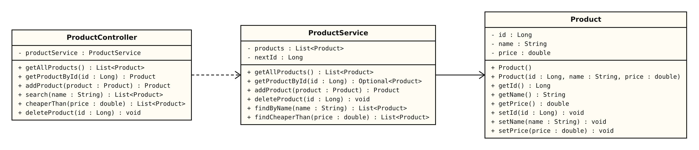
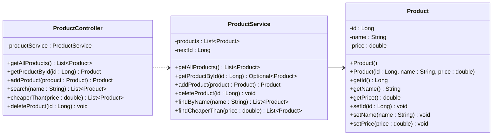

# Product, ProductService and ProductController — UML Class Diagram (Tutorial 3)

PlantUML source: [Product.puml](Product.puml)

- **Dashed arrow (`..>`) = dependency.** ProductController *uses* ProductService to do its work.
- **Solid arrow (`-->`) = association.** ProductService *holds* Products in its list.
- **Nothing points back at the controller.** The service and Product know nothing about HTTP.
